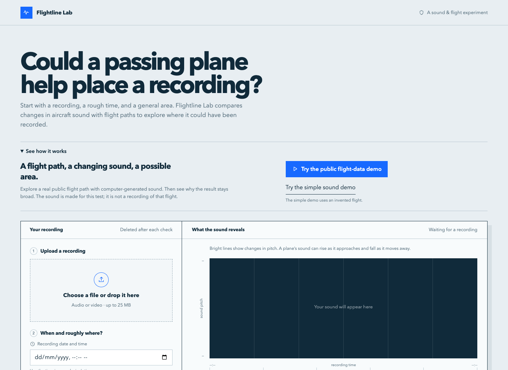
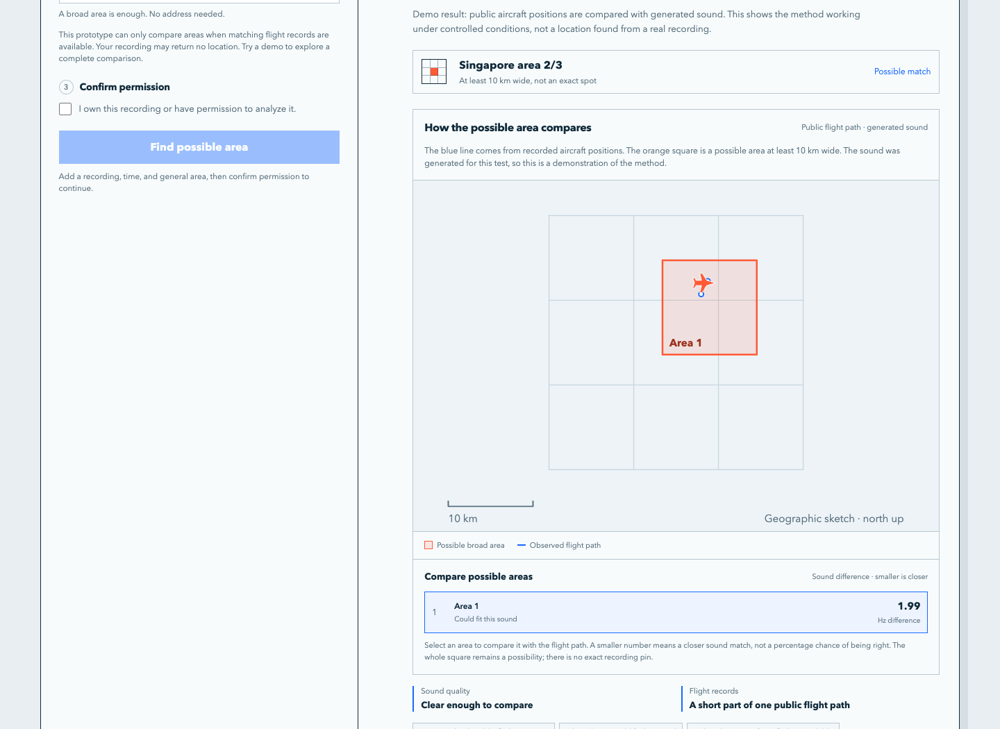

# Flightline Lab

Flightline Lab explores a simple question: can the changing sound of a passing plane help narrow down where a recording was made?



Drop in an audio or video file, add its approximate time and general area, and the app compares the sound with installed public flight observations. It reports broad areas at least 10 km wide. It does not identify an address, a person, an exact microphone position, or a specific aircraft.

## Try the two demonstrations

- **Public flight-data demo:** three anonymous aircraft positions observed near Singapore by adsb.lol are compared with generated sound. The flight positions are real public data; the sound is created specifically to test the matching method.
- **Simple sound demo:** both the flight path and sound are invented. This makes it easy to inspect timing and ambiguity without implying a real-world match.

The Singapore coverage pack spans only 24 seconds on 18 November 2026. A normal upload can use that same public-data path when its area and time overlap the pack. Other places and dates return a clear “no coverage” result instead of a fabricated location.



Public observations are redistributed under the [Open Database License](https://opendatacommons.org/licenses/odbl/1-0/). The pack removes the aircraft identifier and callsign before storage. See `server/packs/README.md` for provenance and format details.

## Why results stay broad

Aircraft noise is not a unique fingerprint. Wind, echoes, clock errors, changing engine pitch, incomplete receiver coverage, and more than one geometrically similar area can all affect a match. Scores compare how closely a sound curve fits; they are not probabilities.

The bundled public demo is a controlled validation, not proof that the method can reliably locate arbitrary recordings. A larger archive and recordings collected at known locations are needed before making stronger claims.

## Run locally

Requirements: Node.js, Python 3.11+, and optionally FFmpeg for compressed audio/video.

```sh
npm install
python3 -m venv .venv
.venv/bin/python -m pip install -r server/requirements-dev.txt
```

Start the API:

```sh
.venv/bin/python -m uvicorn server.main:app --host 127.0.0.1 --port 8000
```

Start the interface in a second terminal:

```sh
npm run dev
```

Open <http://127.0.0.1:5174>.

## Verify

```sh
npm run build
.venv/bin/python -m pytest tests -q
```

## Deploy on Render

The included `Dockerfile` builds the interface, installs FFmpeg and the Python analysis stack, and serves everything from one FastAPI service. `render.yaml` configures a free Render web service.

Free services sleep when idle and may take about a minute to wake. Their filesystem is temporary, so coverage packs are built ahead of time and shipped read-only inside the image. Recordings are processed in a temporary directory and deleted after each request.

See `server/README.md` for API details and model assumptions.
